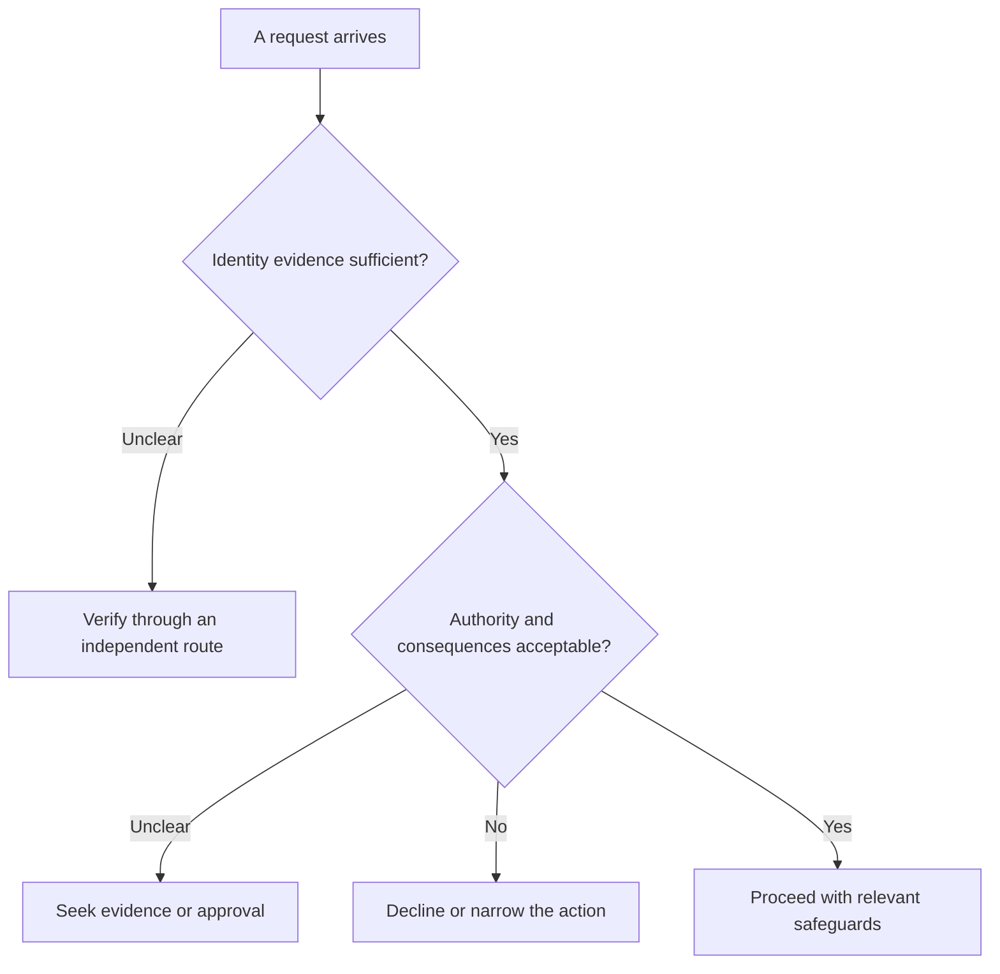

**By Melisa K. Savich**  
_Beyond Authentication · Article 1_

<!-- EDITORIAL NOTES — v1 draft, November 16, 2026
This is a new article draft, separate from the reusable template. The date is a draft date; update it to the actual publication date before publishing. published: false deliberately prevents ordinary Jekyll publication.
Basis: Editorial_Foundation.md and Editorial_Roadmap_v2.md; earlier Roadmap v1 and v0.1 provide context. Personal_Philosophy_and_Discussion_Findings.md informed editorial judgment only; private anecdotes and interpretations have not been reproduced.
[TODO: Before publication, add one individually documented incident if a case study is desired; the BEC discussion below describes documented mechanisms, not a reconstructed individual case.]
[TODO: Check the article in the installed al-folio version: mobile table and TOC, Mermaid, footnotes, generated citation author/date/URL. No site build has been run.]
-->

Imagine a colleague sends you a message from the account you talk to every day. They need a sensitive file, but this time they want it sent to a different address. The name is familiar. The conversation history is there. The request is plausible.

Do you send it?

You might start by asking whether the message really came from your colleague. That's sensible. But suppose you could establish that it did. Would that settle the question?

Your colleague could be mistaken about who should receive the file. They could be asking you to bypass a policy. They could even be deliberately misusing access they legitimately hold. None of those possibilities requires an impersonator.

This hypothetical interaction gets at the question behind this series: **what evidence justifies acting on a request, beyond evidence about who is making it?**

Authentication is valuable. Stronger authentication closes important avenues of attack. But when we ask an identity signal to answer a broader question about trust, we can end up relying on a guarantee it never supplied.

## What a successful login actually tells us

NIST describes digital authentication in terms of verifying control of authenticators associated with a subscriber account. Identity proofing addresses a separate task: establishing a relationship between an online subject and a real-life person to a degree of assurance (Temoshok, Fenton, et al., 2025; Temoshok, Abruzzi, et al., 2025).

That distinction matters. A service can recognize a returning account without knowing its operator's legal identity. Conversely, establishing someone's identity does not establish the purpose of their next request.

Passwords, multifactor authentication, and passkeys offer different protections. They also overlap: a passkey can participate in multifactor authentication, so these are not three mutually exclusive stages of security progress.

| Mechanism                  | Useful assurance                                                                       | A boundary to remember                                                                                      |
| :------------------------- | :------------------------------------------------------------------------------------- | :---------------------------------------------------------------------------------------------------------- |
| Password                   | Evidence of knowledge of an account secret.                                            | A secret can be disclosed or phished.                                                                       |
| Multifactor authentication | Evidence involving distinct factors, rather than a password alone.                     | Phishing resistance depends on the mechanism; an additional factor is not automatically phishing-resistant. |
| Passkey                    | Public-key authentication scoped to the relevant service, designed to resist phishing. | Authenticating an account does not establish that a later request is appropriate.                           |

_The comparison summarizes authentication properties, not a ranking of people or their intentions (Temoshok, Fenton, et al., 2025; FIDO Alliance, n.d.; World Wide Web Consortium [W3C], 2026)._

For passkeys, the service binding is important: the credential is not simply a reusable secret someone can type into a convincing imitation of the website. WebAuthn defines scoped public-key credentials; FIDO describes passkeys as service-bound credentials designed for phishing-resistant authentication (W3C, 2026; FIDO Alliance, n.d.).

That is a meaningful improvement. It still does not tell a recipient whether an authenticated account's request to move money or disclose a file should be honored.

A login can establish a stronger basis for associating activity with an account. The decision about that activity remains a separate problem.

## Several questions hide inside the word trust

For this essay, it helps to separate six questions. These are working distinctions, rather than an attempt to impose one definition across every discipline.

- **Identity proofing:** What evidence connects this online identity to a real-life person?
- **Authentication:** What evidence establishes control of the relevant authenticator?
- **Authorization:** What actions does the applicable policy permit this actor to perform?
- **Message authenticity and integrity:** What evidence supports the claimed source and detects alteration of the message?
- **Reputation:** What do previous observations or other people's reports suggest?
- **Contextual trust:** Given this request, these circumstances, and the consequences, what am I prepared to rely on?

The first two follow the distinction in NIST's identity guidance. The remaining questions organize the analysis here; none should be treated as a substitute for the others.

An authentic message can contain a false claim. An authorized action can still have an unacceptable consequence. A strong reputation can be relevant without becoming permission for every future request.

Consider a hypothetical administrator who has access to a customer database. The system might correctly authenticate them and correctly allow an export under its configured permissions. That does not establish that sending the export to a personal address is acceptable. We may need a narrower policy, a second approval, or a technical restriction on the destination.

The question is no longer simply whether the account belongs to the administrator. It is whether the authority and safeguards fit the action.

## Trust has a social meaning, too

Security terminology can make trust sound like a property a component possesses. Social-science accounts ask different questions: how people form expectations, how relationships make cooperation possible, and what happens when those expectations fail.

Lewis and Weigert (1985), writing in sociology, treat trust as a social phenomenon involving cognitive, emotional, and behavioral dimensions. Their account emphasizes relationships and shared expectations rather than treating trust solely as an isolated individual's calculation.

Organizational researchers Mayer et al. (1995) approach the problem through a model of trust that examines the parties involved and the role of risk. That is a different analytical focus, not a second name for the same theory.

Neither paper provides a ready-made specification for an authentication service. Their relevance here is narrower: they help expose how much disappears when we use a successful identity check as shorthand for an entire relationship.

My working position is that a useful security decision has to be specific about the reliance involved. I might rely on someone to recommend a book without giving them access to my email. That isn't an inconsistency in my opinion of them. Those decisions expose different things to different consequences.

The design implication is to make the requested action and its stakes visible, rather than ask people to make an unlimited judgment about whether another person is trustworthy.

## A familiar account can carry an unfamiliar risk

Business email compromise offers a documented example of how identity cues and action can come apart. The FBI's Internet Crime Complaint Center describes schemes in which criminals compromise legitimate business or personal email accounts to induce unauthorized transfers. The FBI also describes spoofed accounts and access to genuine billing conversations as distinct ways of making fraudulent requests appear ordinary (Federal Bureau of Investigation [FBI], 2024, n.d.).

Those mechanisms should not be collapsed into a single story.

With **impersonation**, a sender tries to appear to be someone else. With **account compromise**, a criminal may operate through an actual account. With **misuse by a legitimate actor**, the person requesting the action may be exactly who they appear to be.

The first two are documented in the FBI guidance. The third is the hypothetical administrator example above; it illustrates a different boundary, rather than claiming a particular incident occurred.

Better authentication can help prevent account takeover. Independent confirmation of changed payment instructions addresses another part of the problem. A restriction on exporting sensitive data addresses another. We should choose controls according to the failure mechanism, rather than expect one reassuring signal to cover all three.

Notice what this does to the opening scenario. Checking the display name is weak evidence. Checking the account gives us more information. Confirming the request through an independently established route can add something different. Reviewing whether the destination is permitted answers a different question again.

“Verified” is useful only if we know what was verified.

## History is evidence, not a permanent guarantee

It would be misleading to say authentication tells us nothing about continuity. NIST explicitly recognizes reasonable, risk-based assurance that a returning subject is the same one who previously accessed a service. Its guidance also addresses session management and monitoring for indicators of potential fraud (Temoshok, Fenton, et al., 2025).

The narrower point is that an authenticated return visit, an ongoing session, and a longstanding human relationship are different kinds of continuity.[^continuity]

Even a perfectly established history of account control would not prove that every future action serves the recipient's interests. Continuity can strengthen the evidence for _same account or operator_ without resolving _appropriate request_.

This also creates a question worth following in later essays: could an adversary accumulate credibility through ordinary interactions, then use that credibility to influence a more consequential decision? And could that influence extend beyond one transaction into which explanations, sources, or judgments a person accepts?

Those are research questions here, not findings established by the email-compromise examples. Demonstrating a fraudulent payment mechanism does not, by itself, demonstrate sustained belief change. The latter needs its own evidence and a more careful account of causation.

[^continuity]: Session continuity is a technical assurance about an authenticated interaction. Relationship history can include experiences, expectations, and social context outside that session. Treating them as distinct does not make either irrelevant.

## What I mean by a trust system

I'm using **trust system** as a working term for the arrangements that help people decide what to rely on, for which purposes, and with what recourse when things go wrong. This is an analytical framing for the series, not a claim that the term has one settled technical definition.

Under that framing, a trust system can include credentials, permissions, communication history, independent confirmation, institutional rules, and ways to challenge or reverse a decision. Some parts are implemented in software. Others are procedures or social arrangements.

Take a hypothetical payment workflow. Authentication protects the employee's account. Permissions limit who can propose a transfer. A separate approval checks the transaction. A known contact route helps verify a changed destination. Records make later investigation possible. The protection comes from how those pieces fit together.

That matters because the harm occurs at the level of an action: money moves, information leaves, or authority is delegated. A system that authenticates successfully while leaving the action poorly bounded may be doing exactly what it was configured to do.

The following sketch expresses the distinction. It is a conceptual aid, not a validated decision algorithm.

In prose: establish the evidence needed for the interaction, then examine the action itself. Where authority or consequences remain unclear, more evidence or a narrower action may be appropriate. A positive answer still leaves residual risk; the diagram does not certify safety.

## The objection worth taking seriously

There is a fair response to all this: security engineering already distinguishes authentication from authorization. Transaction approvals, least privilege, fraud checks, and audit trails are attempts to address what happens after login. Calling this a trust problem could make an established engineering distinction sound like a newly discovered hole in the internet.

I think that objection narrows the claim in a useful way.

The problem is partly about how guarantees are interpreted, and partly about whether controls fit a particular workflow. A system does not necessarily need a new layer called “trust.” It may need a better authorization rule, clearer transaction details, or a usable way to verify a consequential change.

Sometimes the best answer is to reduce how much trust the action requires. Give an application permission to read one file rather than an entire drive. Require another approval before releasing funds. Make a change reversible where possible. These are design choices, not tests of someone's moral character.

More identification is not automatically the right answer either. NIST's identity-proofing guidance calls for data minimization and usable options for people with different means and capabilities (Temoshok, Abruzzi, et al., 2025). A demand for more evidence has costs, and the evidence should earn its place by addressing a relevant risk.

I would be wary of a universal trust score for the same reason: it could conceal what was measured, whose judgment mattered, and whether the result applies to this action at all. That is a design concern to investigate, not proof that every reputation system is harmful.

## Before we decide to act

Return to the colleague asking for a sensitive file.

The goal is not to discover their intentions with certainty. It is to decide whether this disclosure is justified. That might mean confirming the destination through a known route, checking the recipient's authority, limiting what is shared, or seeking approval. For payment changes, independent confirmation also aligns with the FBI's published guidance (FBI, 2024, n.d.).

This is where I'd like the discussion about trust systems to begin: with the evidence a decision needs and the harm a control is supposed to prevent.

Stronger authentication belongs in that picture. So do permissions, context, and recovery. The challenge is to connect them without pretending any one of them can certify another person's future behavior.

For the next part of this series, the question becomes how trust develops, changes, and sometimes becomes a resource an adversary can exploit. First, though, we need to be precise about the decision in front of us.

**What additional evidence should a system communicate before we decide to act?**

## References

Federal Bureau of Investigation. (n.d.). _Business email compromise_. https://www.fbi.gov/how-we-can-help-you/common-frauds-and-scams/business-email-compromise

Federal Bureau of Investigation. (2024, September 11). _Business email compromise: The $55 billion scam_ (Alert No. I-091124-PSA). Internet Crime Complaint Center. https://www.ic3.gov/PSA/2024/PSA240911

FIDO Alliance. (n.d.). _User authentication specifications overview_. https://fidoalliance.org/specifications/

Lewis, J. D., & Weigert, A. (1985). Trust as a social reality. _Social Forces, 63_(4), 967–985. https://doi.org/10.1093/sf/63.4.967

Mayer, R. C., Davis, J. H., & Schoorman, F. D. (1995). An integrative model of organizational trust. _Academy of Management Review, 20_(3), 709–734. https://doi.org/10.5465/amr.1995.9508080335

Temoshok, D., Abruzzi, C., Choong, Y.-Y., Fenton, J., Galluzzo, R., LaSalle, C., Lefkovitz, N., Regenscheid, A., & Vachino, M. (2025). _Digital identity guidelines: Identity proofing and enrollment_ (NIST Special Publication 800-63A-4). National Institute of Standards and Technology. https://doi.org/10.6028/NIST.SP.800-63a-4

Temoshok, D., Fenton, J., Choong, Y.-Y., Lefkovitz, N., Regenscheid, A., Galluzzo, R., & Richer, J. (2025). _Digital identity guidelines: Authentication and authenticator management_ (NIST Special Publication 800-63B-4). National Institute of Standards and Technology. https://doi.org/10.6028/NIST.SP.800-63b-4

World Wide Web Consortium. (2026, August 25). _Web authentication: An API for accessing public key credentials—Level 3_. https://www.w3.org/TR/2026/REC-webauthn-3-20260825/
