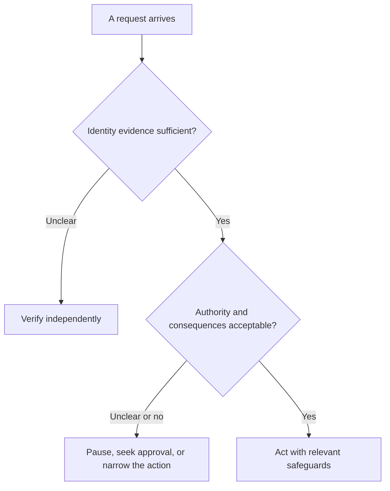

**By Melisa K. Savich**  
*Beyond Authentication · Article 1*

<!-- EDITORIAL NOTES — v1.1 readability revision, November 16, 2026
The date is a draft date; update it before publishing. Keep published: false until review is complete.
Editorial basis: Editorial_Foundation.md and Editorial_Roadmap_v2.md, with v1 and v0.1 as earlier context. Private philosophy informs framing only.
[TODO: Check mobile table, sidebar TOC, Mermaid, and generated citation metadata in the installed al-folio version. No site build has been run.]
[TODO: If expanding the evidence, add an individually documented incident. The BEC discussion describes documented mechanisms, not a reconstructed case.]
Readability reference: https://medium.com/learning-new-stuff/tips-for-writing-medium-articles-df8d7c7b33bf
-->

A colleague messages you from the account you talk to every day. They need a sensitive file sent to a new address.

The name is familiar. The conversation history is there. The request sounds like them.

**Do you send it?**

You might first check whether it's really your colleague. But suppose you could establish that it is. They might still be mistaken about who should receive the file—or asking you to bypass a rule.

This hypothetical request captures the question behind *Beyond Authentication*: what evidence do we need before deciding to act?

A successful identity check helps. It doesn't finish the job.

## A stronger login answers a specific question

Authentication helps establish that someone controls an authenticator associated with an account. Identity proofing is a separate process that connects an online subject to a real-life person, with a stated degree of assurance (Temoshok, Fenton, et al., 2025; Temoshok, Abruzzi, et al., 2025).

Neither tells us whether sending that file is a good idea.

Passkeys improve an important part of this picture. They use public-key credentials bound to the relevant service, helping resist phishing. That's a real benefit, not a reason to declare authentication solved—or pointless (FIDO Alliance, n.d.).

But even a well-protected account can make an inappropriate request.

For our colleague's message, three questions matter:

| Question | What it helps establish |
| :--- | :--- |
| Who is making the request? | Evidence about identity and account control. |
| Are they entitled to ask? | Whether the action fits their authority. |
| Should I comply here? | Whether the destination, purpose, and consequences are acceptable. |

*This is a way to organize the decision, not a checklist that guarantees safety.*

We can have a convincing answer to the first question while the other two remain wide open.

## Familiarity is useful—and exploitable

Business email compromise shows why that distinction matters.

The FBI describes schemes involving spoofed addresses, compromised legitimate accounts, and access to genuine billing conversations. These are different mechanisms, but each can make a fraudulent request look familiar (Federal Bureau of Investigation [FBI], n.d., 2024).

An imitation account raises one problem: the sender isn't who they claim to be. A compromised account raises another: the address may be genuine, but someone else is operating it.

Our opening example adds a third possibility. Your colleague really is asking, but the disclosure still isn't appropriate. That's a hypothetical policy failure, not an incident established by the FBI reports.

These distinctions change what would help. Strong authentication can help prevent takeover. Independent confirmation can help verify a changed destination. A narrower permission can limit what gets disclosed.

The reassuring word *verified* leaves something out unless we also know **what was verified**.

## Trust is bigger than an identity check

In sociology, trust involves more than collecting facts about an individual.

Lewis and Weigert (1985) describe trust as a social phenomenon with cognitive, emotional, and behavioral dimensions. Their account emphasizes relationships and shared expectations: trust helps people cooperate without calculating every possible future.

That perspective is useful here because ordinary relationships aren't a series of fresh identity checks. We develop expectations about people, then rely on those expectations when deciding what to do.

I might trust someone to recommend a book without giving them access to my email. The difference isn't a contradiction. Those decisions put different things at risk.

That's the distinction I want security systems to make easier to see: **trust someone to do what, under which circumstances?**

History can help answer that. It doesn't answer it permanently.

NIST already recognizes reasonable, risk-based assurance for returning users and addresses session management. Authentication isn't oblivious to continuity (Temoshok, Fenton, et al., 2025).

Still, continuity of account access and confidence in someone's next request aren't interchangeable. Even perfect evidence that it's the same operator cannot establish that every future action serves your interests.

This raises a question for later essays: could someone build credibility through ordinary interactions, then use it to influence which requests—or explanations—we accept?

That's a research question here. Email-compromise evidence alone doesn't establish how sustained manipulation changes beliefs.

## A trust system connects evidence to action

I'm using *trust system* as a working term for the arrangements that help us decide what to rely on, for what purpose, and what we can do when something goes wrong.

It isn't one product or a universal score. It can include software, procedures, and relationships.

Consider a hypothetical payment workflow. A protected account identifies the employee. Permissions limit who can initiate a transfer. Another person approves it. A known contact route helps confirm changed bank details.

Each part addresses a different uncertainty. Together, they make the decision less dependent on one person recognizing that something feels wrong.

Here's the distinction in a simple sketch:

*An illustrative decision sketch, not a validated algorithm. The second question still matters after the first is answered.*

## Do we actually need another layer?

Security practitioners could reasonably object that authentication and authorization are already separate concepts. Why dress that distinction up as an internet-wide trust problem?

It's a fair challenge.

My argument isn't that every system needs a new component called “trust.” Sometimes the right fix is a clearer approval process, a narrower permission, or a better explanation of what a verification badge means.

We can also reduce how much trust an action requires. Let an application read one file rather than an entire drive. Require another approval before releasing funds. Make a change reversible where possible.

More identity evidence isn't automatically better, either. NIST's identity-proofing guidance includes data minimization and usable options for people with different means and capabilities (Temoshok, Abruzzi, et al., 2025).

Evidence should address a relevant risk. Collecting more of it has costs.

## Back to that file

You don't need certainty about your colleague's motives to make a sensible decision.

You need to know whether this disclosure is justified. That could mean checking the recipient's authority, confirming the new address through an established route, or sharing less information. The FBI similarly recommends independent confirmation for consequential payment changes (FBI, n.d., 2024).

The useful question becomes:

**What evidence would justify this action, given what I could lose?**

That's where this series starts. Stronger authentication gives us better evidence about account access. The next challenge is connecting that evidence to the decisions people actually face—without pretending we can certify another person's future behavior.

What should a system show us before we decide to act?

## References

Federal Bureau of Investigation. (n.d.). *Business email compromise*. https://www.fbi.gov/how-we-can-help-you/common-frauds-and-scams/business-email-compromise

Federal Bureau of Investigation. (2024, September 11). *Business email compromise: The $55 billion scam* (Alert No. I-091124-PSA). Internet Crime Complaint Center. https://www.ic3.gov/PSA/2024/PSA240911

FIDO Alliance. (n.d.). *User authentication specifications overview*. https://fidoalliance.org/specifications/

Lewis, J. D., & Weigert, A. (1985). Trust as a social reality. *Social Forces, 63*(4), 967–985. https://doi.org/10.1093/sf/63.4.967

Temoshok, D., Abruzzi, C., Choong, Y.-Y., Fenton, J., Galluzzo, R., LaSalle, C., Lefkovitz, N., Regenscheid, A., & Vachino, M. (2025). *Digital identity guidelines: Identity proofing and enrollment* (NIST Special Publication 800-63A-4). National Institute of Standards and Technology. https://doi.org/10.6028/NIST.SP.800-63a-4

Temoshok, D., Fenton, J., Choong, Y.-Y., Lefkovitz, N., Regenscheid, A., Galluzzo, R., & Richer, J. (2025). *Digital identity guidelines: Authentication and authenticator management* (NIST Special Publication 800-63B-4). National Institute of Standards and Technology. https://doi.org/10.6028/NIST.SP.800-63b-4
